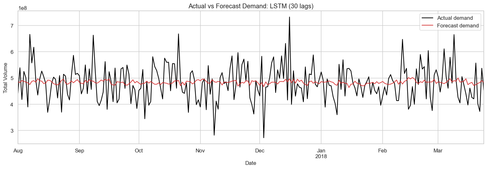
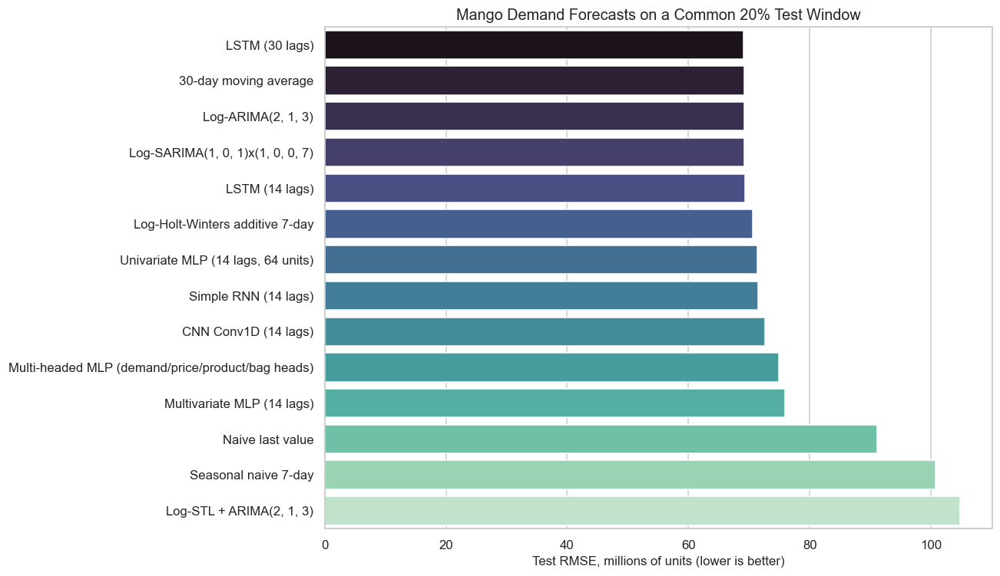

# マンゴー販売量の需要予測

[English](README.md) | **日本語**

マンゴーの日次販売量を予測する、一連の処理を含む時系列分析プロジェクトである。解釈しやすい統計的手法と近年のニューラルネットワークを、共通の将来ホールドアウト期間で比較する。



## プロジェクト概要

当初は価格の予測を目的としていたが、価格の変動が小さく、有意義な予測課題にならなかった。そのため、予測対象を`Total Volume`へ変更した。販売量は価格より変動が大きく、在庫管理、仕入れ、梱包に関する意思決定にも役立つ指標である。

本プロジェクトでは、18,249件の元データを1,176日分の完全な日次データに集約し、探索的分析と定常性の分析を行ったうえで、最後の236日を共通の評価期間として14種類の予測手法を比較する。ニューラルネットワークのハイパーパラメータは、それより前の検証期間を使って選定する。スケーリングと学習には将来の観測値を使用しない。

## 主な結果

テストデータに対して最も低いRMSEを示したのは、30ラグのLSTMであった。

| モデル | MAE（百万単位） | RMSE（百万単位） | MAPE | ナイーブ予測に対するRMSE改善率 |
|---|---:|---:|---:|---:|
| **LSTM, 30 lags** | **54.432** | **69.058** | **11.71%** | **24.19%** |
| 30-day moving average | 54.554 | 69.167 | 11.81% | 24.08% |
| ARIMA(2,1,3), log scale | 54.357 | 69.176 | 11.59% | 24.07% |
| SARIMA(1,0,1)x(1,0,0,7), log scale | 54.449 | 69.250 | 11.50% | 23.99% |
| LSTM, 14 lags | 54.782 | 69.388 | 11.76% | 23.83% |
| Naive last value | 72.020 | 91.100 | 14.02% | 0.00% |

LSTMは、直前の値をそのまま予測値とする手法に対してRMSEを24.19%改善した一方、30日移動平均に対する改善率は0.16%にとどまった。したがって、実用上の結論は慎重に捉える必要がある。系列をモデル化することによる小さな改善は測定できるものの、より単純なモデルも、本番運用で比較すべき有力な候補である。



選定したモデルの平均残差は、百万単位で-2.25（`actual - forecast`）である。日次販売量に対して、平均的にはわずかに過大予測する傾向を示している。残差の標準偏差は百万単位で69.17であり、本番運用では予測区間の算出と継続的な監視が重要となる。

## 手法

- データ検証、日付の欠損確認、1日分の観測がそろっていない日の除外、日次集約
- 記述統計、時系列プロット、移動統計量、ACF/PACF、ADF検定、KPSS検定
- 対数変換、相関分析、STLによる季節分解
- ナイーブ予測、季節ナイーブ予測、移動平均によるベースライン
- ARIMA、SARIMA、STL-ARIMA、Holt-Wintersによる予測
- ハイパーパラメータを調整した単変量MLP、多変量MLP、マルチヘッドMLP
- Conv1D CNN、Simple RNN、14ラグ／30ラグのLSTMモデル
- ニューラルネットワークでは、時系列順に学習65%、検証15%、共通テスト20%へ分割
- MAE、RMSE、MAPE、残差診断、ナイーブ予測に対する改善率の報告

過去の価格、商品コード別販売量、袋の販売量は、ラグを持つ入力としてのみ使用する。これにより、同日の`Total Volume`の構成要素が予測に混入するデータリークを防ぐ。

## リポジトリの構成

```text
.
|-- Mango_Sales_Demand_Forecasting.ipynb  # 実行済みの分析とモデル比較
|-- mango_prices_dataset.csv              # 授業で提供された元データセット
|-- requirements.txt                      # 再現用Python環境
|-- assets/                               # READMEに掲載する図
|-- results/model_comparison.csv          # 全モデルのテスト結果一覧
|-- README.md                             # 英語版README
`-- README.ja.md                          # 日本語版README
```

## ローカルでの実行方法

Python 3.11で動作確認済み。

```bash
git clone https://github.com/KoseiHoriJP/mango-demand-forecasting.git
cd mango-demand-forecasting
python3 -m venv .venv
source .venv/bin/activate
python -m pip install --upgrade pip
pip install -r requirements.txt
jupyter lab Mango_Sales_Demand_Forecasting.ipynb
```

ノートブックは実行済みであり、分析全体とその出力をGitHub上で直接確認することもできる。

## データの出所

`mango_prices_dataset.csv`は、応用情報学（Applied Informatics）の授業プロジェクト用の元データセットとして提供されたものである。ファイルには、公開された出典URLやライセンスの明示はなかった。そのため、本リポジトリでは授業で提供されたデータと記載しており、データセットの所有権を主張していない。

## 制約と今後の課題

このデータには、地域、店舗、販売促進、祝日、天候、供給上の制約に関する情報が含まれていない。また、本プロジェクトで使用した評価方法は、時系列に沿って1回だけ期間を分けるホールドアウト評価である。予測の起点をずらしながら繰り返しバックテストを行うことで、性能の安定性をより確かに評価できる。本番運用を見据えた拡張では、需要に影響する外部要因の追加、予測区間の算出、移動平均やARIMAを比較対象としたLSTMの継続的な監視に取り組む必要がある。
