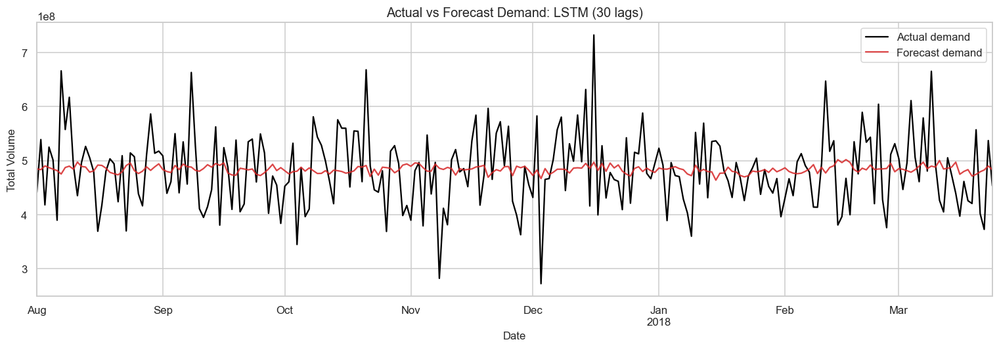
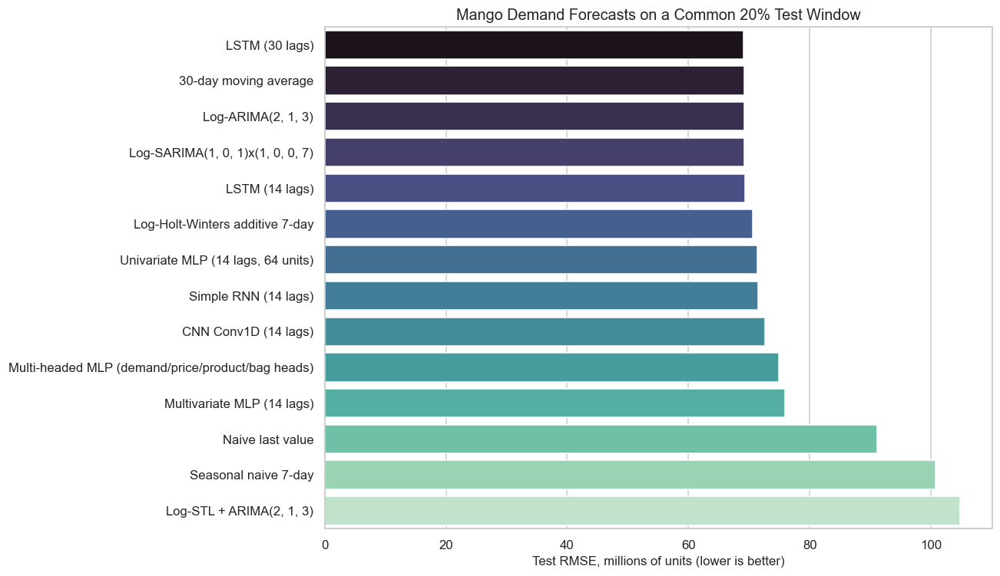

# Mango Sales Demand Forecasting

An end-to-end time-series project that forecasts daily mango sales volume and compares interpretable statistical methods with modern neural networks on the same future holdout period.



## Project Summary

The original project focused on price, but price varied too little to create a meaningful forecasting problem. I reframed the target as `Total Volume`, a more variable and operationally useful measure for inventory, purchasing, and packaging decisions.

The workflow aggregates 18,249 raw observations into 1,176 complete daily records, performs exploratory and stationarity analysis, and evaluates 14 forecasting approaches on the same final 236 dates. Neural-network hyperparameters are selected using an earlier validation period, and no future observations are used during scaling or training.

## Key Result

The 30-lag LSTM produced the lowest test RMSE:

| Model | MAE (millions) | RMSE (millions) | MAPE | RMSE improvement vs naive |
|---|---:|---:|---:|---:|
| **LSTM, 30 lags** | **54.432** | **69.058** | **11.71%** | **24.19%** |
| 30-day moving average | 54.554 | 69.167 | 11.81% | 24.08% |
| ARIMA(2,1,3), log scale | 54.357 | 69.176 | 11.59% | 24.07% |
| SARIMA(1,0,1)x(1,0,0,7), log scale | 54.449 | 69.250 | 11.50% | 23.99% |
| LSTM, 14 lags | 54.782 | 69.388 | 11.76% | 23.83% |
| Naive last value | 72.020 | 91.100 | 14.02% | 0.00% |

The LSTM improves RMSE by 24.19% over the last-value forecast, but only 0.16% over the 30-day moving average. The practical conclusion is therefore nuanced: sequence modeling adds a small measurable gain, while simpler models remain excellent production challengers.



The selected model has a mean residual of -2.25 million units (`actual - forecast`), indicating a small average over-forecasting bias relative to daily volume. Its residual standard deviation is 69.17 million units, so prediction intervals and ongoing monitoring would be important in a production setting.

## Methods

- Data validation, missing-date checks, partial-day removal, and daily aggregation
- Descriptive statistics, time plots, rolling statistics, ACF/PACF, ADF, and KPSS tests
- Log transformation, correlation analysis, and STL seasonal decomposition
- Naive, seasonal-naive, and moving-average baselines
- ARIMA, SARIMA, STL-ARIMA, and Holt-Winters forecasting
- Tuned univariate MLP, multivariate MLP, and multi-headed MLP
- Conv1D CNN, Simple RNN, and 14/30-lag LSTM models
- Chronological 65% training, 15% validation, and 20% common test design for neural models
- MAE, RMSE, MAPE, residual diagnostics, and improvement-over-naive reporting

Historical price, product-code sales, and bag sales are used only as lagged inputs. This avoids leaking same-day components of `Total Volume` into the forecast.

## Repository Contents

```text
.
|-- Mango_Sales_Demand_Forecasting.ipynb  # Executed analysis and model comparison
|-- mango_prices_dataset.csv              # Course-provided source dataset
|-- requirements.txt                      # Reproducible Python environment
|-- assets/                               # README figures
|-- results/model_comparison.csv          # Full test leaderboard
`-- README.md
```

## Run Locally

Tested with Python 3.11.

```bash
git clone https://github.com/KoseiHoriJP/mango-demand-forecasting.git
cd mango-demand-forecasting
python3 -m venv .venv
source .venv/bin/activate
python -m pip install --upgrade pip
pip install -r requirements.txt
jupyter lab Mango_Sales_Demand_Forecasting.ipynb
```

The notebook is already executed, so the complete analysis and outputs can also be reviewed directly on GitHub.

## Data Provenance

`mango_prices_dataset.csv` was supplied as the original Applied Informatics course-project dataset. No public source URL or documented license accompanied the file. The repository therefore describes it as course-provided data and does not claim ownership of the dataset.

## Limitations and Next Steps

The data does not include region, store, promotions, holidays, weather, or supply constraints. The project uses one chronological holdout; repeated rolling-origin backtesting would provide a stronger estimate of performance stability. A deployment-oriented extension should add external demand drivers, generate prediction intervals, and monitor the LSTM against the moving-average and ARIMA challengers.

